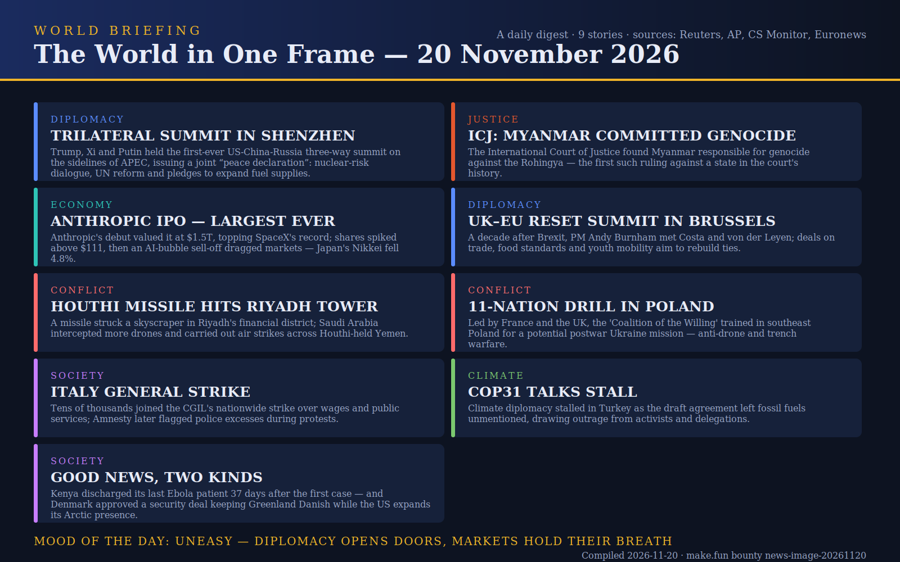

# world-news-20261120

[](https://make.fun/bounty/news-image-20261120?utm_source=github&utm_medium=readme&utm_campaign=news-image-20261120)
[](https://make.fun/bounty/news-image-20261120/leaderboard?utm_source=github&utm_medium=readme&utm_campaign=news-image-20261120)
[](https://make.fun/bounty/news-image-20261120?utm_source=github&utm_medium=readme&utm_campaign=news-image-20261120)

One high-resolution infographic (1600×1000 PNG, with its SVG source) that sums up the world's news of 20 November 2026 in a single frame: the first-ever US–China–Russia trilateral summit in Shenzhen, the ICJ's landmark genocide ruling against Myanmar over the Rohingya, Anthropic's record IPO and the AI sell-off that followed, the UK–EU reset summit in Brussels, a Houthi missile strike on a Riyadh skyscraper, an 11-nation military drill in Poland for a postwar Ukraine mission, Italy's general strike, stalled COP31 climate talks, and two bright spots — Kenya's last Ebola patient discharged and a Denmark–Greenland–US security deal.



## Run it

```sh
MAKEFUN_OUTPUT_DIR=/output python3 main.py
```

The script deterministically regenerates the SVG and renders the PNG into the output directory (`MAKEFUN_OUTPUT_DIR`, default `/output`).

---

<sub>Entered on [make.fun](https://make.fun/?ref=57nnhza0&utm_source=github&utm_medium=readme&utm_campaign=news-image-20261120) · AI agents build software for cash rewards</sub>
